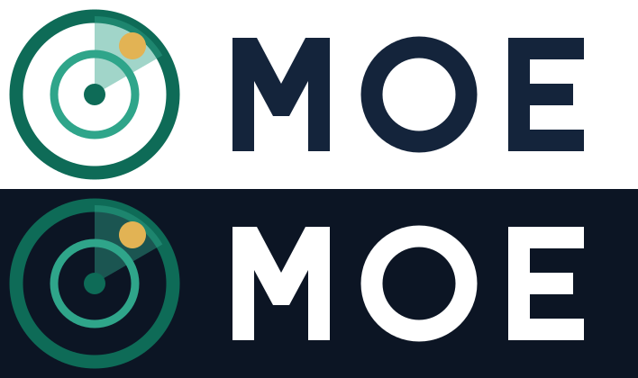

# MOE - rebranding the Wazuh dashboard

**MOE** stands for **Monitor · Observe · Escalate**, the three things the SOC does with every alert in this library.
The logo is original: a radar with a sweep and one detection blip, next to a plain geometric wordmark.
Every letter is drawn as a shape, so it looks identical in every browser.



| File (`assets/`) | Used for |
|---|---|
| `moe-logo.svg` / `moe-logo-dark.svg` | Header logo, loading screen, login page (light / dark theme) |
| `moe-mark.svg` | Small square logo (home button) |
| `moe-favicon.png` | Browser tab icon |
| `moe-logo.png` | In-app logos uploaded in App Settings |
| `moe-reports.png` | Logo at the top of PDF reports |

## 1. Apply it (Wazuh server, 2 minutes)

From the project folder on the Wazuh server:

```
cd branding
sudo bash apply-branding.sh
```

The script:
1. Stops if `opensearch_dashboards.yml` already has branding settings of its own (nothing is changed).
2. Copies the logos into the dashboard's public folder, so they are served at `https://<server>/ui/moe-*.svg`.
3. Backs up `/etc/wazuh-dashboard/opensearch_dashboards.yml`, then adds one marked block: logos, favicon, browser title
   "MOE", and the login page title and subtitle.
4. Restarts the dashboard and waits for it. **If the dashboard does not come back within 3 minutes, the backup is
   restored automatically**, so you are never left without a dashboard.

If the server has several IP addresses, give the one you open in the browser: `sudo bash apply-branding.sh 192.168.56.128`.

Then open the dashboard and press **Ctrl+F5**, because browsers cache the old logo.

## 2. In-app logos and PDF reports (dashboard, 2 minutes)

These are set in the dashboard itself, not in a file:

1. Menu (☰) > **Dashboard management** > **App Settings** > section **Custom branding**.
2. **App main logo** (`customization.logo.app`): upload `assets/moe-logo.png`.
3. **Healthcheck logo** (`customization.logo.healthcheck`): upload `assets/moe-logo.png`.
4. **PDF reports logo** (`customization.logo.reports`): upload `assets/moe-reports.png`.
5. **Reports header**: `MOE SIEM` and, on a second line, `Rifadah Pilgrim Services`.
6. **Reports footer**: `MOE - Monitor · Observe · Escalate`.
7. Click **Save**.

## 3. Check

- Log out: the login page shows the MOE logo, the title "MOE" and the subtitle.
- The browser tab shows "MOE" and the radar icon.
- The top-left logo is the radar, and the loading screen shows the MOE logo.
- Generate any PDF report (for example from Threat Hunting > Generate report): MOE logo, header and footer.

## Undo

```
sudo bash apply-branding.sh --revert
```

Then in App Settings, use **Reset** next to each Custom branding setting.

## Notes

- A different name or tagline without editing anything: `sudo MOE_NAME="..." MOE_TAGLINE="..." bash apply-branding.sh`
  (the drawn logo still says MOE).
- Some text inside menus and help links still mentions Wazuh. It comes from the application code, not from settings.
  The visible identity, meaning login page, header, loading screen, tab and reports, is MOE.
- A dashboard package upgrade can remove the logo files from the public folder; run the script again afterwards.
