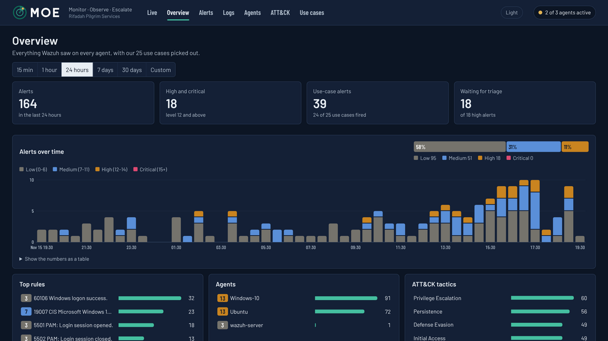

# MOE SOC console

A custom front end for Wazuh, built around the MOE detection library. It runs on the Wazuh server next to the
Wazuh dashboard, reads the same data, and is organised the way a SOC analyst works.

| Page | What it is for |
|---|---|
| **Live** | The live view. The 25 use cases on the attack path (Initial Access to Impact) light up as their rules fire, next to a departures-style board of the newest library alerts. *Start a fresh window* hides earlier alerts, so you see only the use case you just ran. |
| **Overview** | Every alert Wazuh raised in the chosen time range: alerts over time by severity, top rules, agents, ATT&CK tactics, the latest high and critical alerts, which use cases fired, how many high alerts still wait for triage, and the health of the indexer, server API, agents and log pipeline. |
| **Alerts** | Search every alert (ours and Wazuh's built-in rules) by plain words or Wazuh field syntax (`rule.id:111201`, `rule.level:>=12`, `agent.name:Windows-10`). Histogram, filter lists, level, use case and triage filters, CSV export. |
| **Logs** | Search the raw events behind the alerts, including events that matched no rule (needs archiving, see below). |
| **Agents** | Status of every agent, then one page per agent: its alerts, our use cases on it, recent file changes, configuration assessment (SCA), vulnerabilities and system inventory. |
| **ATT&CK** | Coverage matrix: the techniques our use cases detect, and how often each fired in the time range. |
| **Use cases** | The library: for each use case, why it matters in the pilgrim sector, its rules and their XML, log sources, false-positive control, the regression cases, recent alerts and the exact steps to test it live. |

Click any alert or event for the details drawer: every field (with + / − to filter on it), the original log line,
its ATT&CK techniques, the rule that fired (with its XML and what it correlates with), and **triage**: mark it
*Investigating*, *True positive*, *False positive* or *Expected activity* with a note. Triage history is kept on the
server.



## Try it without Wazuh

`python3 demo/run_demo.py` (from the repository root) starts the console on `http://127.0.0.1:8443` against a local
stand-in with sample alerts. It sets `MOE_DEMO=1`, the only mode in which the console accepts a plain-HTTP
upstream, and only on this machine. The system health panel says when it is running on sample data.

The console opens in the dark theme; the **Light** button in the header switches and remembers the choice.

## Install (Wazuh server, about 2 minutes)

From the project folder on the Wazuh server:

```
cd console
sudo bash install-console.sh
```

It asks one thing: **a console password** you choose (at least 10 characters, typed twice). You sign in with user
`moe` and this password. Only a hash of it is stored.

It then creates the console's own **read-only** accounts without asking for any other password:

- **Indexer:** it signs in to the indexer's security API with the indexer's admin certificate
  (`/etc/wazuh-indexer/certs/admin.pem`, readable only by root; the same certificate Wazuh's own password tool
  uses). Only if that certificate is missing or refused does it ask for the dashboard login (three tries, Enter
  skips). Neither the certificate nor any password is copied or saved.
- **Server API:** it uses the API account the Wazuh dashboard already uses, read from the dashboard's own settings.

At the end it checks what the service can reach (indexer, raw logs, server API, rule files, triage storage) and prints
the address, for example `https://192.168.56.128:8443`. The browser warns about the certificate the first time,
because the console made its own: choose **Advanced > Accept**.

### Raw logs for the Logs page (optional)

By default Wazuh stores only events that match a rule. To search every event, turn archiving on:

```
sudo bash install-console.sh --enable-logs
```

It backs up `ossec.conf` and `filebeat.yml`, sets `<logall_json>yes</logall_json>` and Filebeat's
`archives: enabled: true`, checks the configuration, and restarts wazuh-manager and Filebeat. Events from then on
appear on the Logs page. It uses disk space: when you no longer need it, `sudo bash install-console.sh --disable-logs`.

### Other commands

| Command | Does |
|---|---|
| `sudo bash install-console.sh` again | Updates the app; keeps the password and the working connections. |
| `--reset-password` | Choose a new console password. |
| `--no-login` | Open the console without signing in. Anyone who can reach the server on port 8443 can then read every alert and log, so use it only on the lab network and turn it back on afterwards. |
| `--login` | Sign-in back on (the default). |
| `--connect` | Re-create the read-only Wazuh accounts (after a reinstall of Wazuh or a certificate change). |
| `--uninstall` | Removes the service, files, user and the console's Wazuh accounts (asks for the admin password to remove the indexer account). |

## How it is built

| Choice | Why |
|---|---|
| Least-privilege accounts | Indexer role `moe_console_read` can only read `wazuh-alerts-*`, `wazuh-archives-*` and the vulnerability, monitoring and statistics indices. The API user has Wazuh's built-in `readonly` role. The console cannot change Wazuh. |
| The browser never talks to Wazuh | Only the console service holds the read-only credentials (`/etc/moe-console/console.env`, root:moe-console 0640). Index names, fields and query shapes are fixed in the service; what you type only becomes a search value. |
| Certificates checked | The indexer against the Wazuh root CA; the server API against its certificate fingerprint taken at install time. |
| Runs as user `moe-console` in group `wazuh` | Reads `alerts.json` and the rule files; writes only its triage database in `/var/lib/moe-console`. |
| Hardened systemd service | `NoNewPrivileges`, read-only system (`ProtectSystem=strict`), no home, no capabilities, private /tmp and devices. |
| HTTPS with its own certificate, login with a PBKDF2 hash | Failed logins are slowed down. |
| Strict Content-Security-Policy, all Wazuh data rendered as text only | Alert fields are attacker-controlled (URLs, command lines, user names). A payload such as `` shows as text and never runs. Tested. |
| Triage changes need a JSON request with a custom header from the same origin | Another web site cannot forge them through the browser's saved login. |
| CSV export neutralises formulas | A cell that starts with `=`, `+`, `-` or `@` is exported as text. |
| Python standard library only | Nothing to install with pip on the Wazuh server. |

The Live page follows `alerts.json` directly (alerts appear within about 2 seconds, even if the indexer is slow); the
other pages query the indexer and the server API.

## If something is wrong

- A yellow box on a page explains what is missing and the command that fixes it (for example `--connect`).
- *"The console cannot read the Wazuh alert file"*: check that `id moe-console` lists the group `wazuh`, then
  `sudo systemctl restart moe-console`.
- The page does not open: `sudo systemctl status moe-console` and `journalctl -u moe-console -n 30 --no-pager`.
- From another machine: the firewall may block port 8443 (`sudo ufw allow 8443/tcp` if ufw is on).

Fonts: Barlow and Barlow Condensed by Jeremy Tribby, SIL Open Font License (`app/static/fonts/OFL-Barlow.txt`).
